# Pay to Unlock: Encrypted Data with a Fiber Payment

My submission for the **Build on CKB** Fiber campaign, **Quest 1 (Basic)**.

I completed the interactive tutorial [Unlock Encrypted Data with a Fiber Payment](https://www.fiber.world/docs/build/encrypted-data-payment) (Fiber v0.10.1) in the browser on **CKB Testnet** in November 2026. A seller encrypts a report and shares it with a 1 CKB invoice. A buyer pays the invoice through a routing node, and the payment itself reveals the key that decrypts the report.

> **Testnet only.** All funds here are Testnet CKB from the faucet. No private keys, seed phrases, passwords or browser-storage contents are included in this repo.

---

## Contents

- [What this project shows](#what-this-project-shows)
- [The three nodes](#the-three-nodes)
- [How the payment unlocks the data](#how-the-payment-unlocks-the-data)
- [Walkthrough with screenshots](#walkthrough-with-screenshots)
- [Payment summary](#payment-summary)
- [What the payment does and does not guarantee](#what-the-payment-does-and-does-not-guarantee)
- [Notes from my run](#notes-from-my-run)
- [Personal reflection](#personal-reflection)
- [Repository structure](#repository-structure)
- [Links](#links)

---

## What this project shows

Selling digital content usually needs trust in one direction. Either the buyer pays first and hopes the seller delivers, or the seller delivers first and hopes the buyer pays.

This flow removes that problem with one idea: **the encryption key and the payment secret are the same value.**

1. The seller encrypts the report and hands the buyer the **encrypted** version up front.
2. The seller creates a Fiber invoice whose **payment preimage** (the secret that settles the payment) **is the AES key**.
3. To collect the money, the seller must reveal the preimage. Revealing it gives the buyer the key.
4. So the buyer gets the key **only if** the payment settles, and the seller gets paid **only if** the key is released.

No backend server holds the content or the key. Everything runs in the browser using Fiber nodes compiled to WebAssembly.

---

## The three nodes

| Node | Role | Where it runs |
|---|---|---|
| **Buyer A** | Receives the encrypted offer, pays the invoice, decrypts the report | Browser (Fiber WASM node) |
| **Bottle B** | Public Testnet node that forwards the payment from A to C | Fiber Testnet |
| **Seller C** | Encrypts the report, creates the 1 CKB invoice, releases the key by settling | Browser (Fiber WASM node) |

Browser nodes can start connections but cannot accept them, so A and C each open a channel with Bottle B. The payment travels **A → B → C**.

---

## How the payment unlocks the data

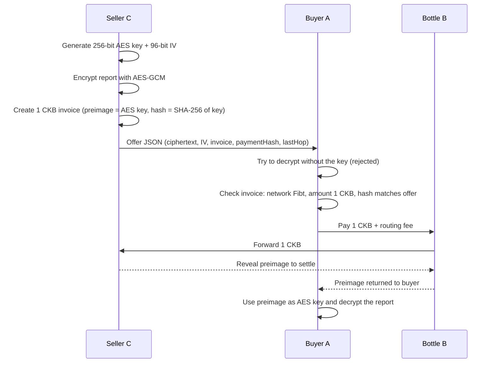

**Key details**

- **Cipher:** AES-256-GCM, done with the browser's Web Crypto API. GCM is authenticated, so a wrong key is rejected outright instead of producing garbled text.
- **Invoice:** 1 CKB in currency `Fibt` (Fiber Testnet), `hash_algorithm: sha256`, `payment_preimage` set to the AES key.
- **Offer JSON** sent to the buyer contains `version`, `cipher`, `ciphertext`, `iv`, `invoice`, `paymentHash` and `lastHop` (the final channel into Seller C, so the buyer's node can find a route).
- **Buyer-side check:** before paying, the buyer confirms the invoice is on `Fibt`, is exactly 1 CKB and has the same payment hash as the offer.

---

## Walkthrough with screenshots

### 1. Setup: both channels reach `CHANNEL_READY`

Both browser nodes were started and funded from the CKB Testnet Faucet. Each node then opened a 500 CKB channel with Bottle B. Of each 500 CKB, 100 CKB is reserved for on-chain settlement and 400 CKB is spendable. Bottle B contributes 250 CKB to each channel, which leaves 150 CKB spendable on its side.

Each channel moves through six opening states before payments are allowed:
`NEGOTIATING_FUNDING` → `COLLABORATING_FUNDING_TX` → `SIGNING_COMMITMENT` → `AWAITING_TX_SIGNATURES` → `AWAITING_CHANNEL_READY` → `CHANNEL_READY`

All six states ticked off on both channels. The balances in this shot sit slightly off the round numbers (399.995 / 151.005) because I had just tried the optional "Send 5 CKB to Bottle" rebalance test — see [Notes from my run](#notes-from-my-run):

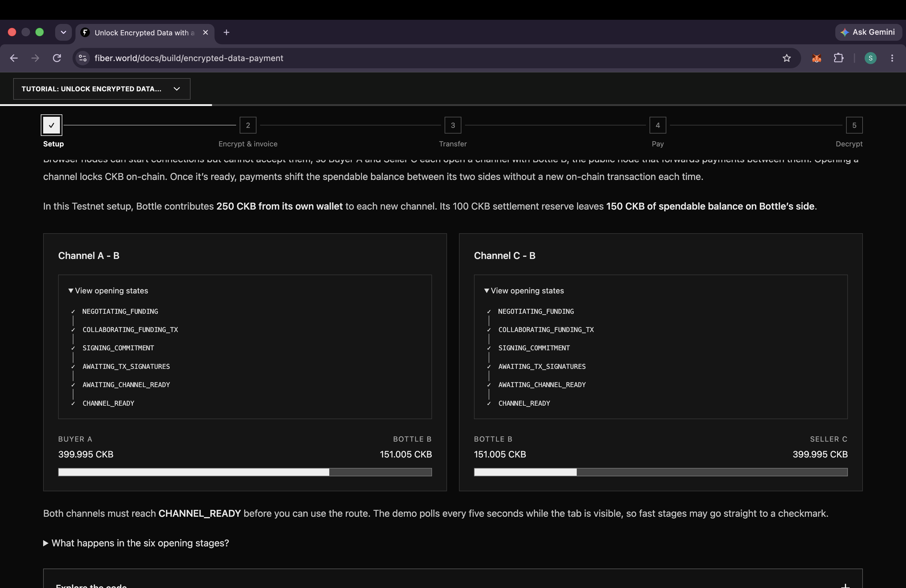

The channels used for the purchase, open at Buyer A 400 CKB / Bottle B 150 CKB and Bottle B 150 CKB / Seller C 400 CKB, right before the payment:

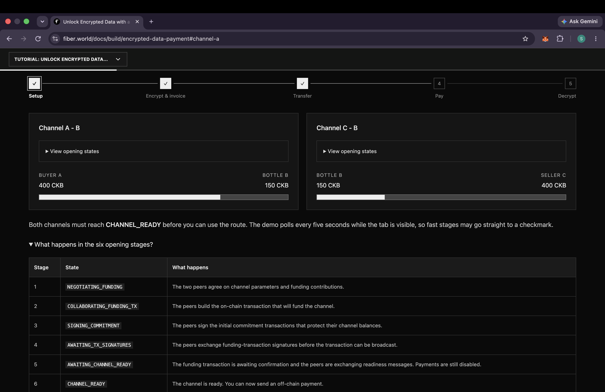

### 2. Seller encrypts the report and creates the invoice

Seller C used the sample report. **Encrypt result** generated a fresh AES key and IV in the browser and produced the ciphertext. **Create 1 CKB Invoice** then created an invoice using that AES key as the preimage.

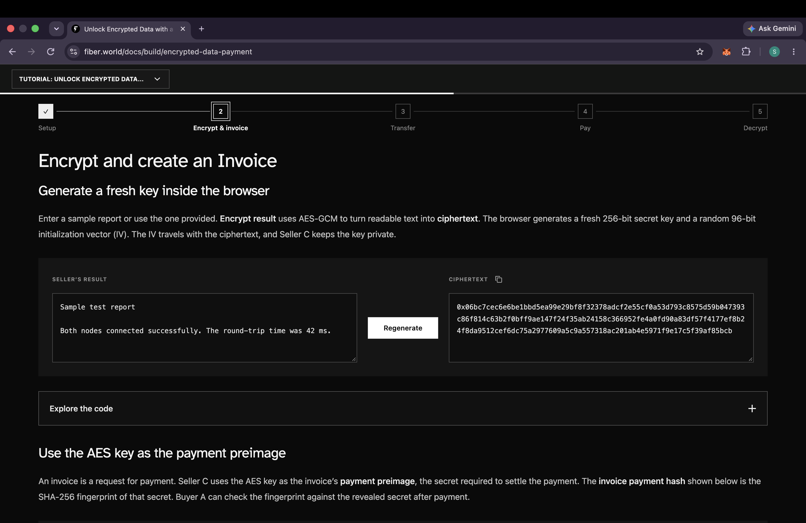

The invoice requests 1 CKB. Its payment hash is the SHA-256 fingerprint of the AES key, so the buyer can check the revealed key against it after paying.

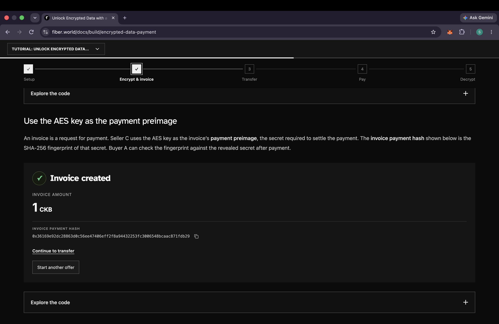

### 3. Before payment: the buyer has the offer but cannot read it

The offer was delivered to Buyer A. The buyer can see the ciphertext, IV, invoice and payment hash, but not the key.

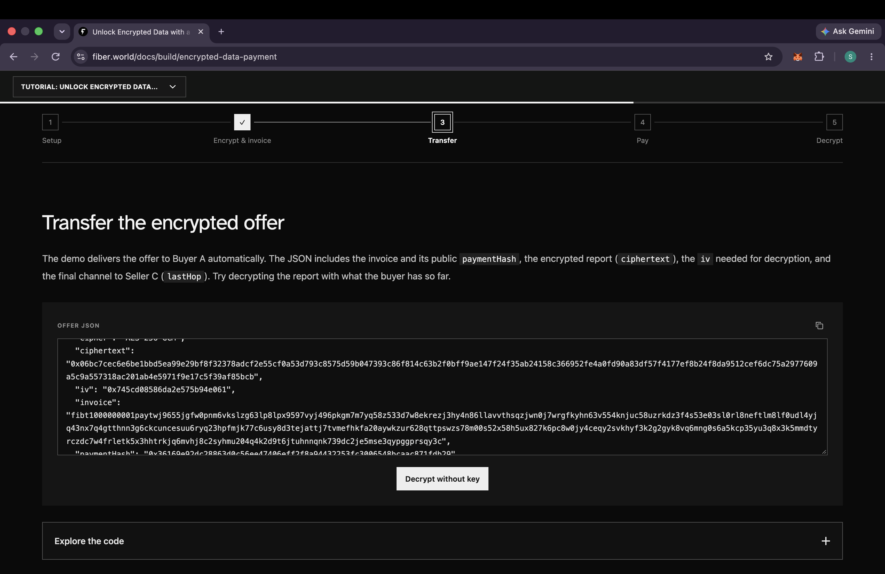

**Decrypt without key** tried a substitute key. AES-GCM rejected it.

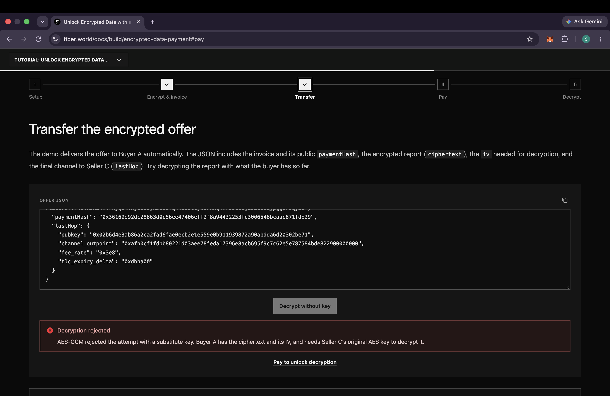

### 4. Pay the invoice

Buyer A paid the 1 CKB invoice through Bottle B. While the payment was in flight, the invoice stayed **Open**:

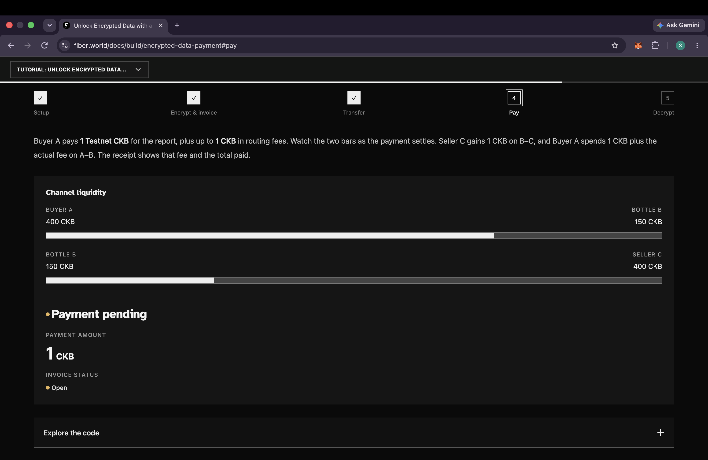

The offer was validated before funds were sent, and the payment completed with invoice status **Paid**. The liquidity bars show 1.001 CKB leaving Buyer A and 1 CKB arriving at Seller C.

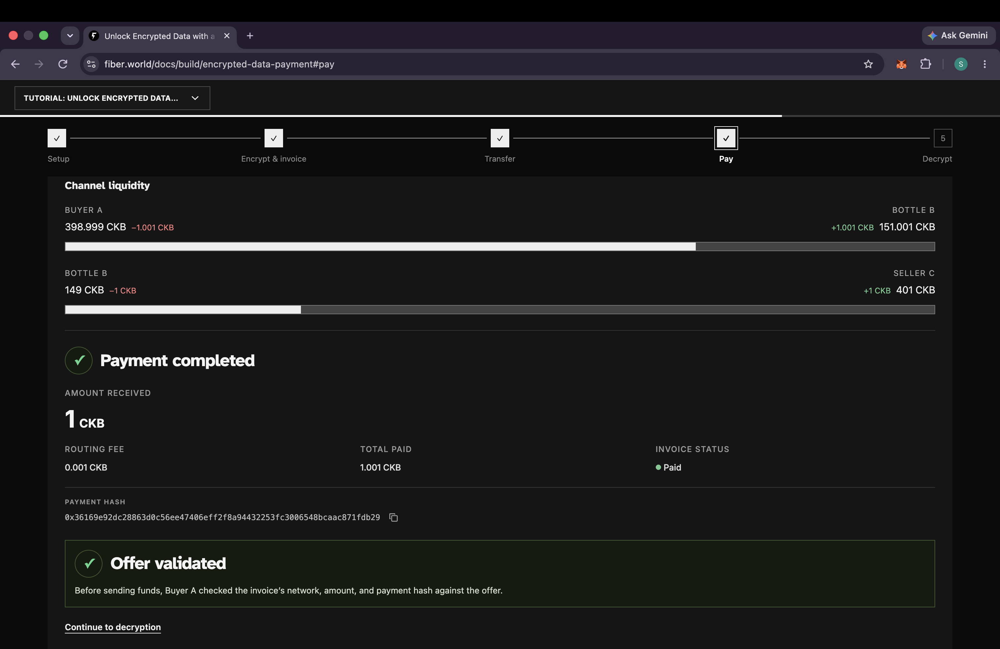

### 5. Decrypt with the revealed key

Settling the payment returned the preimage to Buyer A. **Decrypt result** used it as the AES key and recovered the original report, word for word.

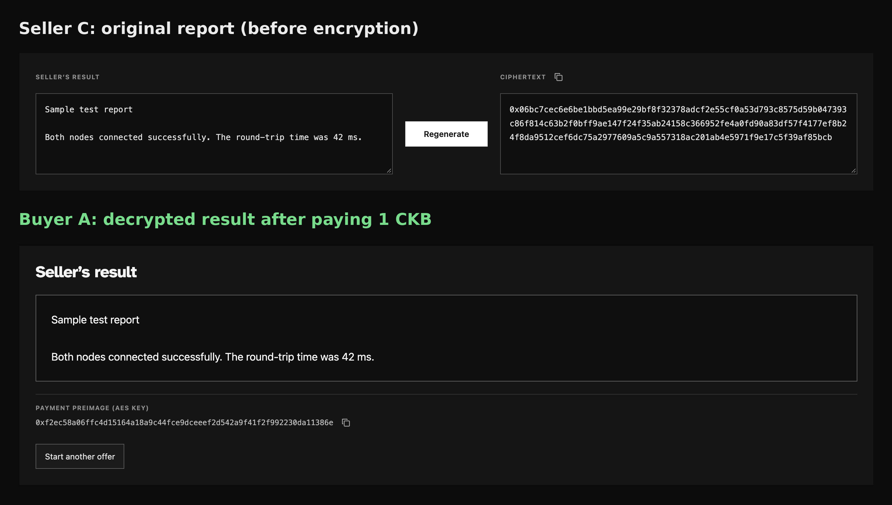

Full decryption screen:

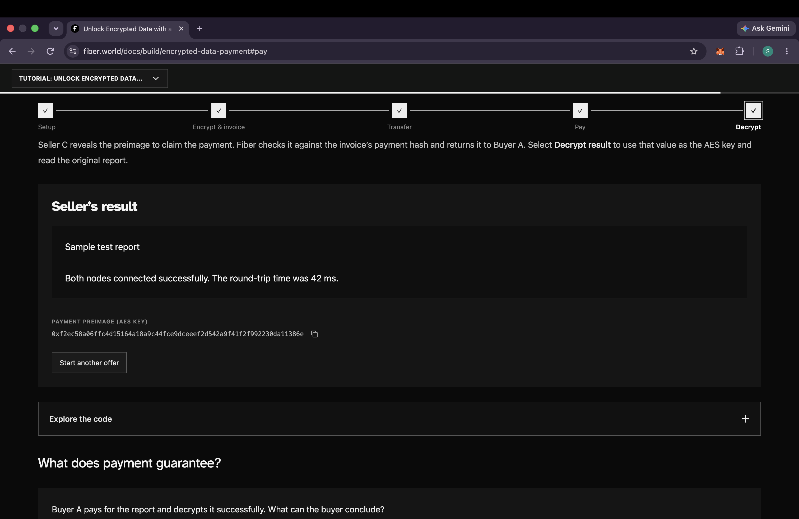

---

## Payment summary

| Field | Value |
|---|---|
| Network | CKB Testnet (Fiber currency `Fibt`) |
| Route | Buyer A → Bottle B → Seller C |
| Amount received by seller | **1 CKB** |
| Routing fee | 0.001 CKB |
| Total paid by buyer | 1.001 CKB |
| Invoice status | Paid |
| Payment hash | `0x36169e92dc28863d0c56ee47406eff2f8a94432253fc3006548bcaac871fdb29` |
| Revealed preimage (AES key) | `0xf2ec58a06ffc4d15164a18a9c44fce9dceeef2d542a9f41f2f992230da11386e` |

The payment hash is the SHA-256 fingerprint of the preimage, so anyone can check that the revealed key is the one the invoice committed to.

**Channel balances after payment**

| Channel | Before | After |
|---|---|---|
| A to B | Buyer A 400 / Bottle B 150 | Buyer A 398.999 (−1.001) / Bottle B 151.001 (+1.001) |
| B to C | Bottle B 150 / Seller C 400 | Bottle B 149 (−1) / Seller C 401 (+1) |

The same payment hash appears in the invoice, the offer JSON and the receipt, which ties the screenshots to one single purchase.

---

## What the payment does and does not guarantee

A successful payment and decryption proves that **the released key matches the ciphertext**. It does **not** prove that the report itself is accurate or useful. Judging the content still needs trust or verification, for example free previews, seller reputation or dispute rules in a real marketplace.

The tutorial ends with a check on exactly this point:

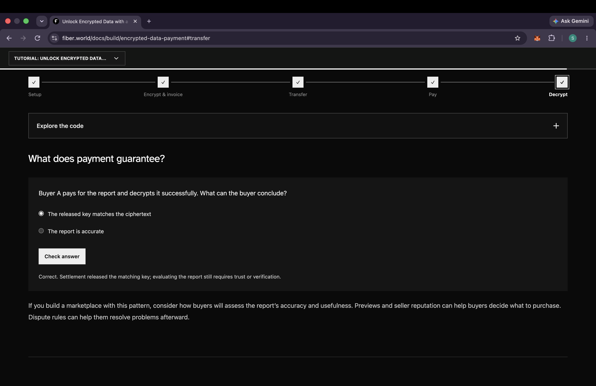

---

## Notes from my run

| Step | What appeared | What I did |
|---|---|---|
| Starting Buyer A | `Node error: Cross-origin isolation is required. Reload this page once.` | Reloaded the page, then started both nodes again |
| Optional "Send 5 CKB to Bottle" | `Transfer needs review: The transfer outcome is unknown` | Did not resend; the route already had enough liquidity, so I continued |
| Paying | Pay button disabled with `Get the Buyer A → Bottle channel ready` | Opened both channels again and waited for them to be ready, then paid |

**1. Node error when starting Buyer A**

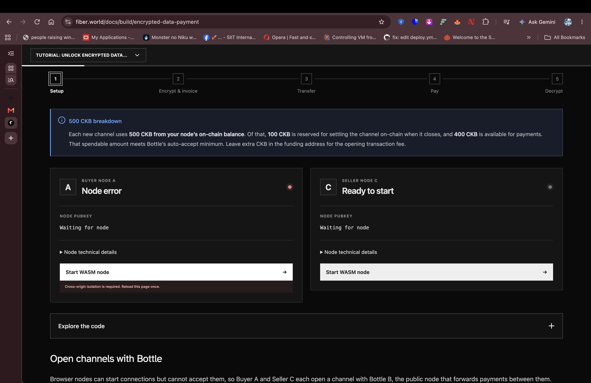

**2. Optional rebalance with an unknown outcome**

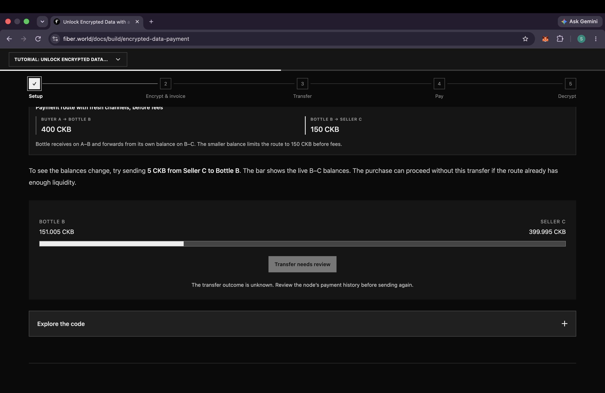

**3. Pay blocked until the Buyer A channel was ready**

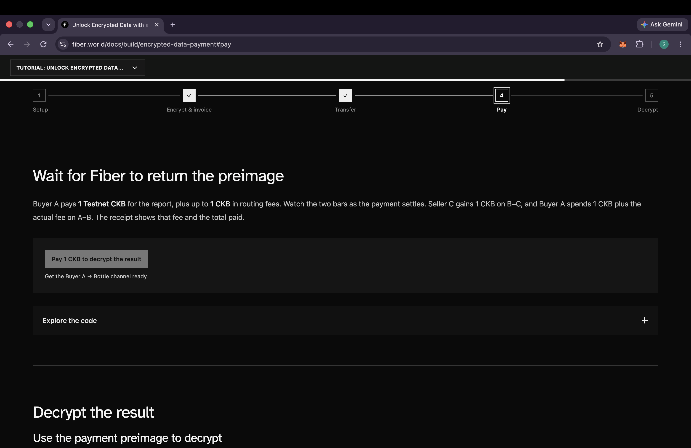

---

## Personal reflection

**How did it feel to have the explanations alongside each interactive step? (required)**

It made the tutorial feel like a guided lab instead of a wall of theory. Every time I pressed a button, the text right next to it told me what had just happened and why it mattered — for example, after opening the channels, the page explained the 500 CKB breakdown (100 CKB reserved for on-chain settlement, 400 CKB spendable) at the exact moment I was staring at those numbers. I never had to jump to a separate reference page to understand what I was looking at, and the "Explore the code" panels were there when I wanted to go a level deeper without being forced to.

**What surprised you or stood out about paying to unlock the report?**

The simplicity of the core trick: the AES key and the payment preimage are literally the same value. I expected some escrow contract or a trusted third party to hold the key, but there is none — the seller *cannot* take the money without revealing the key, because revealing the preimage is how a Fiber payment settles. Watching the "Decrypt without key" attempt get rejected by AES-GCM, then seeing the exact same ciphertext open instantly after a 1 CKB payment, made the atomicity feel very concrete.

**If you ran into a problem, what did you expect, what happened, and how did you resolve it?**

I hit three. First, starting Buyer A failed with `Node error: Cross-origin isolation is required. Reload this page once.` — I expected the WASM node to just start, but a single page reload fixed it, as the message said. Second, the optional "Send 5 CKB to Bottle" rebalance came back as `Transfer needs review: The transfer outcome is unknown`; instead of resending (and risking a double payment), I checked that the route already had enough liquidity and moved on. Third, the Pay button stayed disabled with "Get the Buyer A → Bottle channel ready" — I reopened both channels, waited for `CHANNEL_READY` on each, and the payment then went through on the first try.

**What would you like to build using this pay-to-unlock flow?**

A pay-per-report data marketplace — for example, selling API health reports, scraped datasets or analysis results where each item is encrypted up front and its invoice is the key. Because the whole flow runs in the browser with no backend holding content or keys, even a small static site could sell unlockable content, with Fiber handling both the micropayment and the key delivery in one atomic step.

**If you could change one thing about the tutorial, what would it be?**

Clearer handling of the "Transfer needs review" state in the optional rebalance step. The message says the outcome is unknown and to review payment history before sending again, but the tutorial page itself doesn't show that history or say how to confirm what happened. A short note on how to verify whether the 5 CKB actually moved would remove the one moment of real uncertainty in an otherwise smooth run.

---

## Repository structure

```
ckb-fiber-pay-to-unlock/
├── README.md
└── screenshots/
    ├── 01-setup-both-channels-channel-ready.png
    ├── 01b-setup-both-channels-open-before-payment.png
    ├── 02-before-payment-encrypted-offer-buyer.png
    ├── 03-before-payment-decryption-rejected.png
    ├── 04-after-payment-receipt-1ckb-payment-hash.png
    ├── 05-after-decryption-original-vs-decrypted.png
    ├── 05a-seller-original-report.png
    ├── 05b-after-decryption-result-matches-original.png
    ├── story/
    │   ├── invoice-created-1ckb-payment-hash.png
    │   ├── payment-pending-1ckb.png
    │   └── quiz-what-payment-guarantees.png
    └── issues/
        ├── node-error-cross-origin-isolation.png
        ├── transfer-needs-review.png
        └── pay-blocked-channel-not-ready.png
```

The numbered screenshots in `screenshots/` are the four required campaign screenshots plus supporting shots. `story/` fills in the steps between them, and `issues/` shows the problems I ran into.

---

## Links

- Tutorial: [Unlock Encrypted Data with a Fiber Payment](https://www.fiber.world/docs/build/encrypted-data-payment)
- Fiber Network: [fiber.world](https://www.fiber.world)
- CKB Testnet Faucet: [faucet.nervos.org](https://faucet.nervos.org)
- Author: [github.com/Maxima24](https://github.com/Maxima24)
